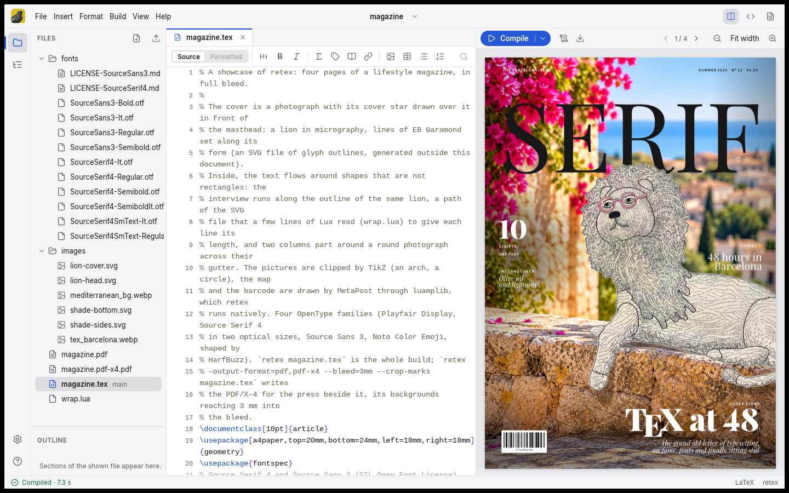
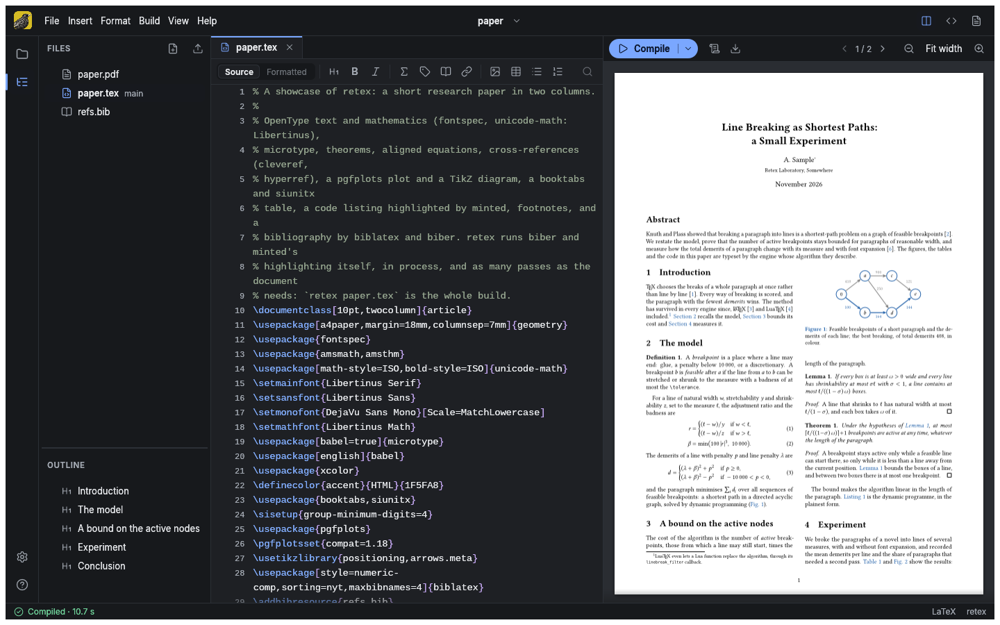
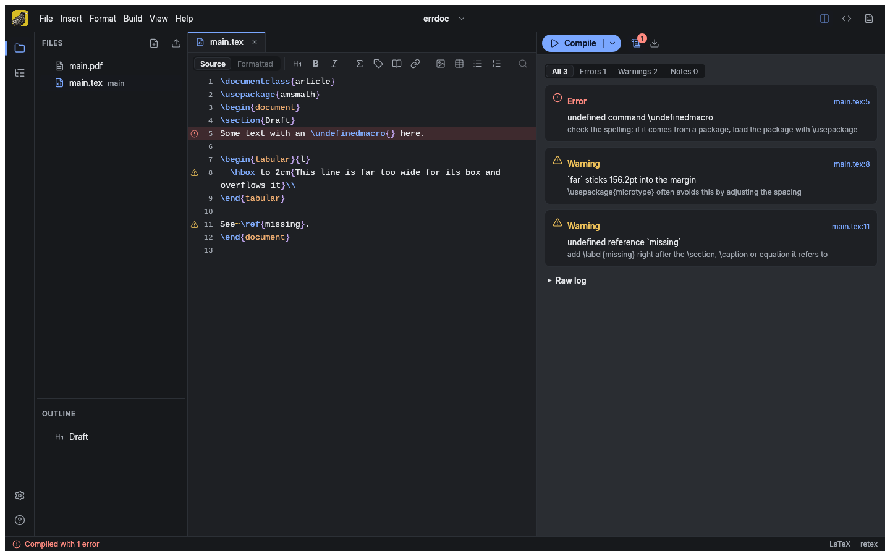
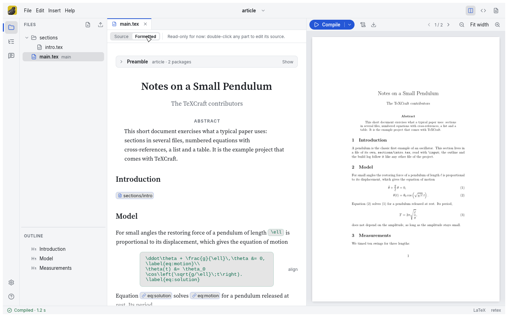
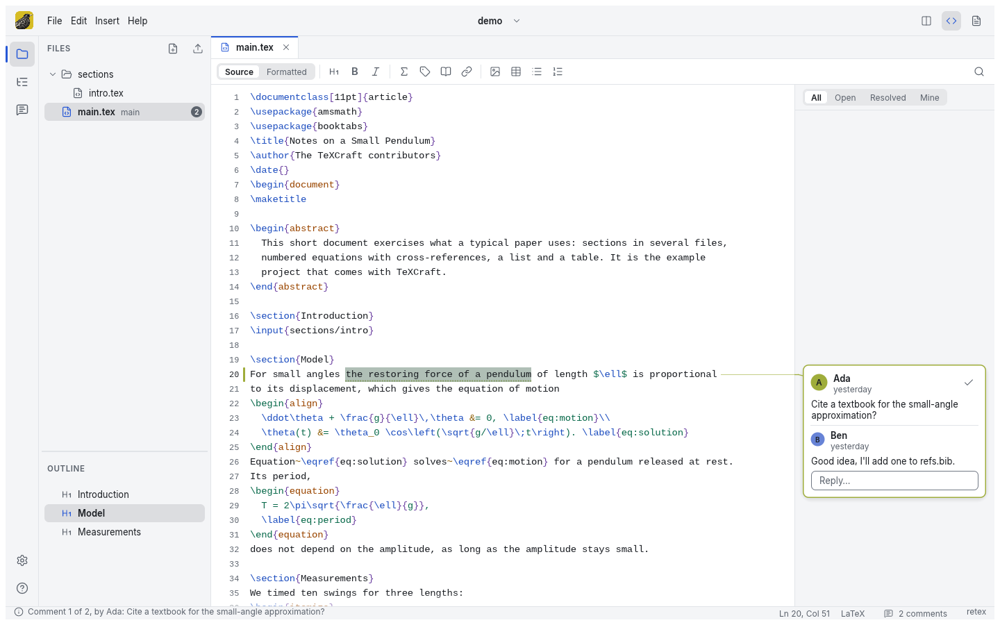
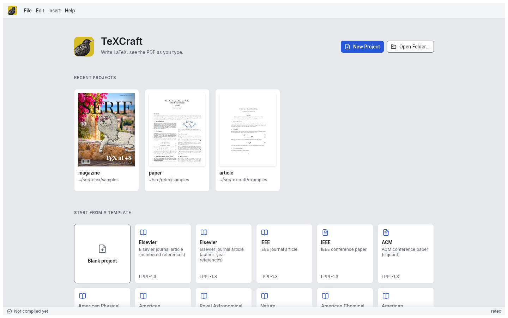

<p align="center">
  
</p>

<h1 align="center">TeXCraft</h1>

<p align="center">
  <b>LaTeX writing; an open-source editor that shows the PDF as you type, built in pure Rust.</b>
</p>

<p align="center">
  A project of files, a source editor and the PDF side by side, rebuilt as you type by
  <a href="https://gitlab.com/severin-lemaignan/retex">retex</a>, a TeX engine written in Rust.
  It runs natively on Linux, macOS and Windows, and in the browser.
</p>

<p align="center">
  <a href="https://texcraft-893d51.gitlab.io/"></a>
  &nbsp;
  <a href="#downloads"></a>
</p>

<p align="center">
  
  
  
  
  
  
</p>

<br>

<p align="center">
  
  <br><sub><b>The magazine</b>: four full-bleed pages with OpenType fonts, photographs, TikZ and MetaPost, built by retex inside TeXCraft · retex's <code>samples/magazine</code></sub>
</p>

<p align="center">
  <a href="#a-look-around">A look around</a> ·
  <a href="#why-texcraft">Why TeXCraft</a> ·
  <a href="#what-retex-brings">What retex brings</a> ·
  <a href="#quick-start">Quick start</a> ·
  <a href="#features">Features</a> ·
  <a href="#status">Status</a> ·
  <a href="#user-guide">User guide</a> ·
  <a href="#downloads">Downloads</a> ·
  <a href="#license-and-credits">License</a>
</p>

## A look around

<table>
<tr>
<td width="50%" valign="top">
  
  <p align="center"><sub><b>Outline and dark theme</b>: a two-column paper with theorems, a TikZ diagram and a biber bibliography · retex's <code>samples/paper</code></sub></p>
</td>
<td width="50%" valign="top">
  
  <p align="center"><sub><b>Build log</b>: each message as a card with retex's help, a link to its line, and markers in the gutter</sub></p>
</td>
</tr>
<tr>
<td width="50%" valign="top">
  
  <p align="center"><sub><b>Formatted view</b>: the same file as a document, headings, lists, references and formulas, beside its PDF</sub></p>
</td>
<td width="50%" valign="top">
  
  <p align="center"><sub><b>Review</b>: comments beside their passages, kept in the project and shared through git</sub></p>
</td>
</tr>
<tr>
<td colspan="2" valign="top">
  
  <p align="center"><sub><b>Start page</b>: recent projects with the first page of their last PDF</sub></p>
</td>
</tr>
</table>

## Why TeXCraft

- **Familiar.** The arrangement people know from online LaTeX editors: project files on the left, the source in the middle, the PDF on the right, the build log in the PDF's place, an Insert menu and a toolbar for the usual markup.
- **The PDF follows your typing.** A build starts when typing pauses, and the PDF keeps its place across builds.
- **Messages you can act on.** retex explains errors and warnings in words, with help on how to fix them; each one links to its line, and the editor marks the lines.
- **Yours, offline.** A project is a folder on your disk, opened, saved and versioned like any other.
- **Agent-native.** Every command of the menus can be run over a JSON control channel of the open window and by an **MCP server**, confined to the folders it is given.
- **One codebase.** The same Rust interface on the desktop and in the browser, where the engine runs in the page, with no server.

## What retex brings

TeXCraft builds with [retex](https://gitlab.com/severin-lemaignan/retex), a TeX engine written in Rust that runs inside it. A few things work that a LaTeX setup usually needs extra tools for:

- **More image formats.** `\includegraphics` takes **SVG** directly (no Inkscape, no `-shell-escape`), **JPEG XL**, **WebP**, GIF and TIFF, as well as PNG, JPEG and PDF.
- **No TeX installation needed.** A package the document needs and the installed TeX Live lacks is downloaded from TeX Live; without a TeX Live at all, retex keeps a tree of its own.
- **Bibliographies and indexes without external programs.** BibTeX, biber and makeindex are built into the engine (no Perl, no Java), and run as many times as the document needs within one build.
- **minted without Python.** Code listings are highlighted in process, without Python, Pygments or `-shell-escape`.
- **Colour emoji** in documents, through OpenType colour fonts.

## Quick start

```sh
git clone https://gitlab.com/severin-lemaignan/texcraft
cd texcraft

cargo run --release -p texcraft                                   # start page
cargo run --release -p texcraft -- examples/article               # open a project folder
cargo run --release -p texcraft -- --control                      # + JSON control channel
cargo run --release -p texcraft-cli -- compile examples/article   # build without a window
cargo xtask ci                                                    # fmt, clippy, tests, layering, wasm32 build
```

TeXCraft needs Rust 1.95 (`rust-toolchain.toml` selects it) and finds TeX Live as retex does: an installed TeX Live 2025 or 2026, or the tree retex downloads.

The interface uses Inter from [storytold/craft-fonts](https://github.com/storytold/craft-fonts), an optional build input: clone it into `./craft-fonts`, which `.cargo/config.toml` points `CRAFT_FONTS_DIR` at. Without it, egui's bundled fonts are used.

### Use it from Claude Code and other agents

Register the MCP server, giving it the folders it may read and write:

```sh
claude mcp add texcraft -- /path/to/texcraft-cli mcp --automation-read-root /work/thesis --automation-write-root /work/thesis
```

It refuses to start without both. The open window's control channel is described in [`docs/control-protocol.md`](docs/control-protocol.md).

## Features

**Writing**
- TeXCraft's own source editor: completion, hover help, quick fixes, find and replace, search across
  the project's files, folding, several carets, and Vim key bindings.
- A formatted view that shows the document as prose: edit its text, headings, lists, tables (as a
  grid) and figures there, each edit a small change to the source.
- Typeset formulas in the formatted view, a symbol palette, spell checking that skips commands,
  maths and code.

**Building**
- The PDF rebuilt as you type, a draft first while later passes run, and source ↔ PDF navigation
  both ways.
- A build log with search, plain explanations of the messages, and the build's files to save.
- Export to DOCX, OpenDocument, PPTX (first choice for beamer slides), HTML, Markdown and SVG,
  plus accessible and print-ready PDFs.

**Projects, history and git forges**
- Every project is a git repository, with its versions to compare and restore, whether or not it
  is ever sent anywhere.
- Projects from publishers' templates; drop in folders and zip files.
- GitLab and GitHub, gitlab.com, github.com or your own servers: sign in, open a project with its
  branches, commit, pull, open a merge request, save a new project as a repository, push and pull.

**Working with others**
- Comments on passages and suggested changes, in a margin beside the text or a review panel.

**AI assistance (optional, desktop)**
- Off until you connect a model of your choice, a service or one on your own computer. Settings
  list what each kind of request may send, with a switch for each, and the prompts to change.
- Explain build errors, rewrite or change a selection, make tables, equations and diagrams from a
  description, draft references, ask about the project, and review a section in comments.

**Everywhere**
- Linux, Windows and macOS, and the browser (the engine runs in the page, projects stay in it).
- Keyboard first and screen-reader aware, a layout for narrow windows and phones.
- An automation channel and an MCP server, so agents can do everything the window does.

## Status

TeXCraft is young and moves fast: a release most days. It is used daily on Linux; the Windows and
macOS builds are experimental (unsigned), and some features are new enough that they have only
been tested by TeXCraft's own test suite so far. [`docs/ROADMAP.md`](docs/ROADMAP.md) lists what is
done (with the release it came in) and what is planned; [`CHANGELOG.md`](CHANGELOG.md) what each
release brought; [`docs/retex-changes.md`](docs/retex-changes.md) what TeXCraft uses of retex and
asks of it.

**Next:** more of the formatted view, translations of the interface, grammar checking, a user
guide, and packages downloaded in the browser.

**Workspace:** `crates/{project, buffer, latex, compile, preview, history, forge, gitwire, review,
templates, vim, wasi, engine, ui-egui, mcp}` and `apps/{texcraft, texcraft-cli, texcraft-web}`. The egui frontend is its
own crate, so the interface can change without touching the engine; nothing below it depends on
egui (`cargo xtask layers`). The interface's look is described in [`docs/design.md`](docs/design.md).

Agent and contributor rules are in [`AGENTS.md`](AGENTS.md), which also lists the checks for the
crates you change.

## User guide

The [user guide](https://texcraft-893d51.gitlab.io/guide/) explains every part of TeXCraft, on the desktop and in the browser; in the app it is Help › User Guide (F1). Its pages are in [`docs/guide/`](docs/guide/index.html).

## Downloads

**In the browser:** [texcraft-893d51.gitlab.io](https://texcraft-893d51.gitlab.io/), nothing to install. The engine runs in the page; projects stay in your browser.

Releases are on the [releases page](https://gitlab.com/severin-lemaignan/texcraft/-/releases): an AppImage and a Flatpak bundle for Linux (x86_64), and the browser build. What changed is in [CHANGELOG.md](CHANGELOG.md).

**Experimental Windows and macOS builds** are attached to the same releases on the [GitHub mirror](https://github.com/skadge/texcraft/releases): a zip for Windows (x86_64) and an app for macOS (Apple Silicon). They are not signed: Windows asks before running it the first time (More info › Run anyway), and on macOS open it with a right-click › Open the first time. Elsewhere, build it from source as shown in [Quick start](#quick-start).

## License and credits

TeXCraft is dual-licensed under [MIT](LICENSE-MIT) or [Apache-2.0](LICENSE-APACHE), at your option. Copyright (c) 2026 the TeXCraft contributors. Required notices are in [NOTICE](NOTICE).

The typesetting engine and language server are [retex](https://gitlab.com/severin-lemaignan/retex) (CC0-1.0). The interface builds on the Craft shared libraries ([storytold/craft-libs](https://github.com/storytold/craft-libs), MIT OR Apache-2.0) and egui.

Bundled fonts, icons and other assets keep their own open licenses; each one is listed with its author, source and license in [ATTRIBUTION.md](ATTRIBUTION.md). The screenshots show retex's magazine and paper samples, made for retex and released with it under CC0-1.0.

The app icon (an engraved blackbird on TeXCraft gold, `#d6bc25`) is the project owner's original artwork; its palette and files are in [`assets/app-icon/`](assets/app-icon/README.md).
